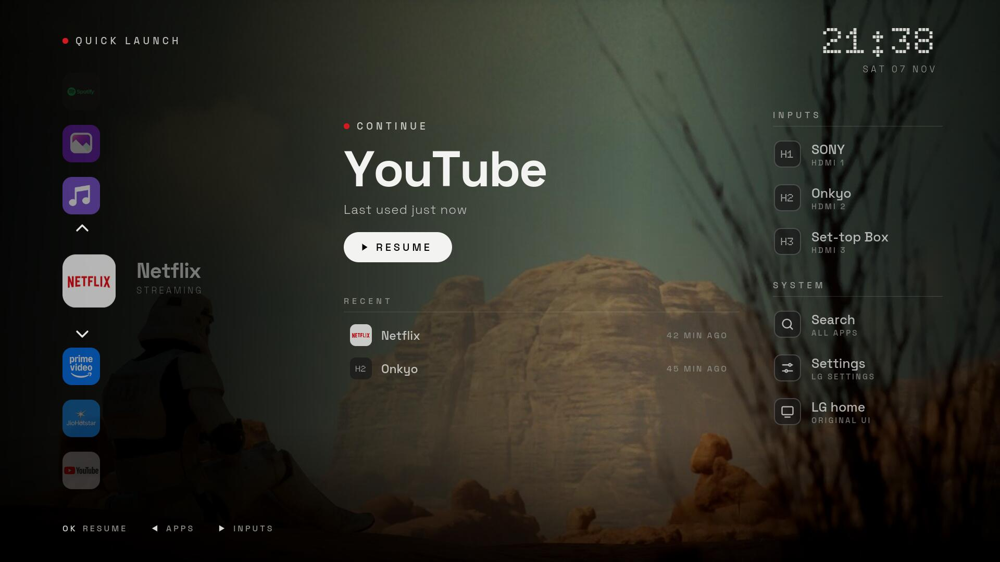
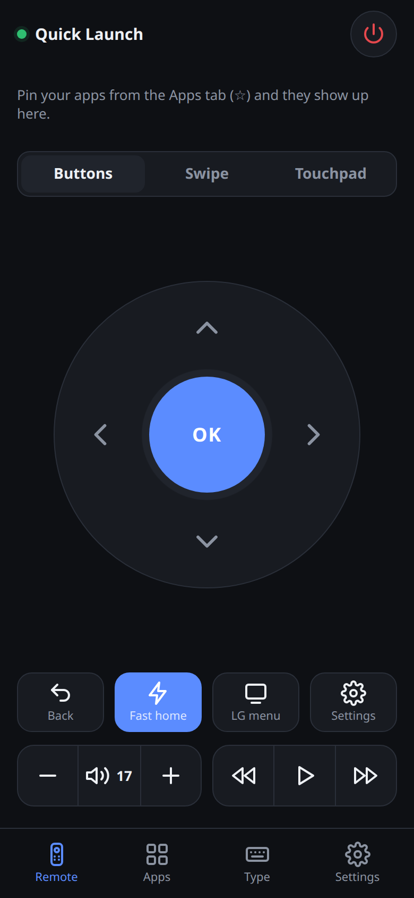
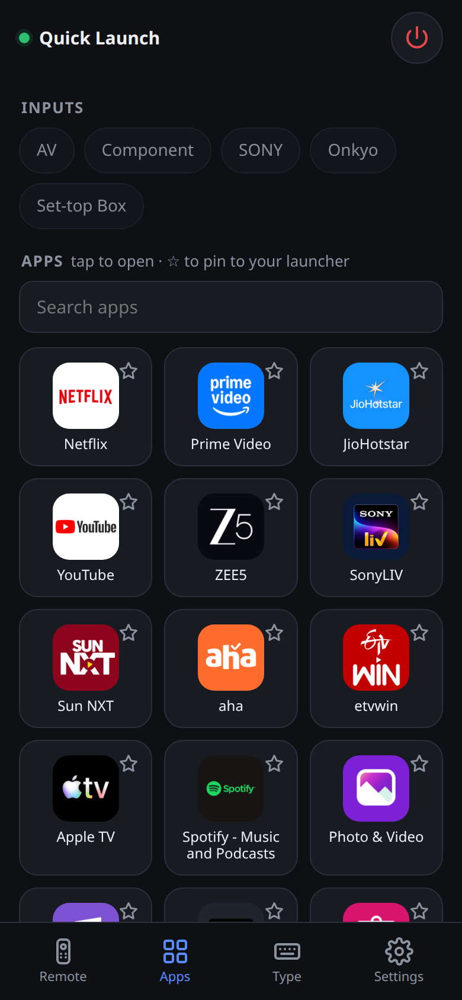

# Quick Launch: a faster LG TV with a phone remote

A replacement home screen and a phone remote for LG webOS TVs, built for a
2018 LG 55UK6360PTE (webOS 4.1) whose physical remote was a poor copy and whose
home screen was slow and full of preinstalled apps.

Nothing on the TV is uninstalled, rooted or changed. The original LG interface
is always one press away.



<p>
  
  &nbsp;
  
</p>

## What's in it

| Part | What it does |
|---|---|
| **Phone remote** | Web app for any phone: D-pad, swipe and touchpad modes, every app and input, volume, media keys, and typing with the phone's own keyboard. |
| **Quick Launch** | A home screen app installed on the TV: one looping roll of your apps, a Continue panel for what you were last using, and a permanent Inputs & System panel. |
| **Remote server** | Small Python server (runs on an Android phone, a PC, or a Pi) that talks to the TV, serves the phone remote, opens Quick Launch when the TV turns on, and remembers what you used. |

```
 phone / iPhone ──http──▶ remote server ──LG local API (ws:3000)──▶ TV
                          (Termux or PC)  ◀── power, app and input events
                                                       │
                                    Quick Launch app on the TV (Developer Mode)
```

## Quick start

You need Python 3.12 and [uv](https://docs.astral.sh/uv/) on a PC, and the TV on the same Wi-Fi.

```bash
git clone git@github.com:Sreemaee21/lg-tv-quick-launch.git
cd lg-tv-quick-launch
uv run python -m tvremote          # finds the TV on the network, prints the remote's address
```

Open the printed address (for example `http://192.168.1.4:8080`) on your phone.
The TV shows a pairing prompt the first time: press **Accept**. The key is saved in
`data/state.json` and never needs pairing again.

If the PC has a firewall, allow the port from your home network, for example:

```bash
sudo ufw allow from 192.168.1.0/24 to any port 8080 proto tcp
```

## Run the server on an Android phone (no PC needed)

1. Install **Termux** and **Termux:Boot** from F-Droid. Both must come from the same
   store, or Android won't let them work together. Open Termux:Boot once.
2. With the PC server running, run this in Termux:
   ```bash
   curl -s http://<pc-ip>:8080/setup/termux.sh | bash
   ```
   It installs Python and the server, pairs with the TV, and adds a `tvremote` command.
   Running it again later updates the code and keeps your pairing and pins.
3. Keep it alive (Android 15 example, Motorola):
   - Settings → Apps → Termux → App battery usage → **Unrestricted**, and turn off
     *Pause app activity if unused*. Do the same for Termux:Boot.
   - Developer options → **Disable child process restrictions**. To unlock Developer
     options, search Settings for "Build number" and tap it seven times.
   - Leave the Termux notification in place: it holds the wake lock.

The server restarts itself within two seconds if Android kills it, and starts at boot
through Termux:Boot. Each boot adds a line to `~/tvremote/boot.log`.

### iPhone

iPhones can't run the server, but they can use the remote: open the server's address in
Safari, then **Share → Add to Home Screen**. Give the server phone a fixed address in the
router (DHCP reservation) so the shortcut keeps working.

## Install Quick Launch on the TV

1. From the LG Content Store, install **Developer Mode** and sign in with a free account
   from developer.lge.com. Turn on **Dev Mode Status** (the TV restarts), then **Key Server**.
2. On the PC, with the passphrase shown in the Developer Mode app:
   ```bash
   uv run python -m tvremote.install_tv_app --passphrase ABC123
   ```
   The Developer Mode key is saved in `data/`, so later installs need no passphrase.
3. Put Quick Launch first on LG's home bar: press **Home**, highlight Quick Launch, press
   **Up** (or hold OK), move it to the first spot, press **OK**. Now **Home, OK** opens it.
   The installer tells you if a reinstall moved it.

LG ends Developer Mode sessions after about 1000 hours, which would remove the app. The
remote server extends the session once a day, the same as pressing *Extend* in the
Developer Mode app.

Re-run the installer after installing or removing TV apps. LG doesn't let developer apps
read the app list, so the list, icons and brand colours are copied in at install time.

## Using it

### Quick Launch (TV)

| Column | Contents |
|---|---|
| Left: the roll | Your apps in one endless loop. Up/Down browses, OK opens, **hold OK** removes an app. |
| Middle: Continue | The app or input you used last, focused when Quick Launch opens, so **OK resumes** it. Three recent items below. |
| Right: panel | HDMI inputs, Search, Settings and the original LG home. Always visible. |

Left/Right moves between columns and Back returns to the roll. Every other app lives in
**Search**: hold OK on one to add it to the roll (a red dot marks apps already on it).

### Phone remote

- **Remote**: D-pad with hold-to-repeat, Swipe (flick to move, tap for OK), or Touchpad
  (drag the pointer, tap to click, two fingers to scroll). Buttons fire on touch-down.
- **Apps**: main apps first, the rest folded into *Other apps*. Tap to open, ☆ to pin.
- **Type**: select a text field on the TV and a typing bar pops up on the phone.
- **Settings**: Fast UI on/off, open the launcher at power-on, channel keys, colour keys.

### Back to the original LG UI

The **LG home** item in Quick Launch, the **LG menu** button on the phone, or the physical
Home key. Turning **Fast UI** off on the phone makes everything behave like stock. Stopping
the server or uninstalling Quick Launch leaves the TV as LG shipped it.

## Speed

Built for a 2018 TV with a slow processor: the launcher is plain ES5 for its Chromium 53
browser, uses no blur or animated shadows, animates only transforms and opacity, and does
all image work (brand colours, background scaling) on the PC at install time.

Measured on the 55UK6360PTE, from the power button to Quick Launch on screen:

| Step | Time |
|---|---|
| TV back on Wi-Fi | about 1.5–2 s |
| Server notices and launches | +0.15 s |
| Launcher starts | about 3.5 s |
| **Total** | **about 5.5 s** |

Two TV settings make the difference (both reversible, both locked against apps):

- *General → Mobile TV On → Turn on via Wi-Fi*: keeps Wi-Fi up in standby (about 10 s
  without it) and lets the phone turn the TV on.
- *General → Quick Start+*: on.

Cutting background bloat also helps: turn off *Live Plus* and *Home Promotion*, and untick
the viewing-information and ad agreements under *About this TV → User Agreements*.

## Customising

- **Default roll**: `DEFAULT_ROLL` at the top of `tvremote/tv/tv.js`.
- **Background**: any picture, rotated, scaled to 1920×1080, darkened and saved small:
  ```bash
  python3 contrib/import_background.py "picture.png" --rotate ccw --dim 0.35
  uv run python -m tvremote.install_tv_app
  ```
  Without one, the original twin-suns background (`contrib/make_background.html`) is used.
- **Fonts**: [Doto](https://fonts.google.com/specimen/Doto) and
  [Space Grotesk](https://fonts.google.com/specimen/Space+Grotesk) (SIL OFL), bundled as
  static files because the TV's browser has no variable-font support.

## Limits

These come from LG locking webOS 4 down for apps. Getting around them needs rooting,
which this project deliberately avoids.

- The physical **Home** key always opens LG's home bar (hence Home, OK).
- Apps can't change TV settings, reorder the home bar, or read the installed app list.
- Continue shows the app or input you used, not the episode: other apps' content isn't visible.
- Quick Launch opening at power-on needs the remote server running somewhere.
- The TV's screenshot API sometimes returns a stale frame.

## Troubleshooting

| Problem | Fix |
|---|---|
| Phone can't reach the remote (timeout) | Same Wi-Fi as the TV (not guest), type `http://` with `:8080`, turn off VPN or mobile data, open the PC firewall. |
| `curl` broken in Termux (`SSL_set_quic…`) | `apt update && apt full-upgrade -y`, then re-run the setup line. |
| Server doesn't start at phone boot | Termux and Termux:Boot from the same store, Termux:Boot opened once and Unrestricted. Check `~/tvremote/boot.log`. |
| Pairing prompt timed out | Reopen the remote on the phone; it asks again. |
| Quick Launch gone from the TV | Developer Mode expired: renew it in the Developer Mode app and re-run the installer. |

## Project layout

```
tvremote/
  __main__.py        web server: phone remote, launcher API, phone setup endpoints
  tv_link.py         TV connection, power-on launch, recent history, keyboard relay
  install_tv_app.py  builds the .ipk and installs it over Developer Mode (no LG SDK)
  pngcolor.py        tiny PNG decoder for icon brand colours
  web/               phone remote (HTML/CSS/JS)
  tv/                Quick Launch TV app (ES5 for webOS 4)
contrib/             Termux setup, background tools, systemd unit
tests/               fake LG TV + end-to-end test
docs/                screenshots
```

## Tests

```bash
uv run python tests/test_e2e.py
```

Runs the real server against a fake TV that speaks LG's protocol, with a scripted phone:
pairing, every remote action, keyboard relay, recent history, Wake-on-LAN MAC learning,
power-on launch, and that Wi-Fi drops or Netflix in front never pop the launcher.

## Credits

- [aiowebostv](https://github.com/home-assistant-libs/aiowebostv) for the LG protocol.
- Fonts under the SIL Open Font License (`tvremote/tv/fonts/LICENSE.txt`).
- The TV screenshot shows a personal background picture, which is not part of the repository.

Not affiliated with or endorsed by LG Electronics. App names and icons belong to their owners.
